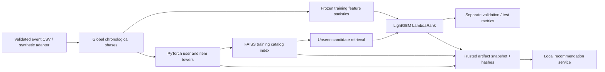

# RecSys — Two-Stage Recommendation & Ranking

A reproducible recommendation project using **Python, PyTorch, FAISS and LightGBM**. Learned neural user/item towers retrieve unseen candidates through a FAISS index; a downstream LambdaRank model reranks those candidates. Offline evaluation reports Recall@K, NDCG@K, MRR@K and HitRate@K for both stages and a popularity baseline.

The repository includes structured source code, numerical/integration tests, synthetic and MovieLens aggregate reports, a local recommendation CLI, saved-model integrity checks and Windows/Linux CI. It is a research demonstration, not a deployed production recommender.

## Resume feature coverage

| Résumé capability | Implemented evidence |
|---|---|
| Neural two-tower candidate retrieval | Separate learned ID embedding + Linear/ReLU/Linear towers, normalized vectors and sampled pairwise logistic training |
| FAISS indexing | `IndexFlatIP` on neural item embeddings, persisted index, ID/row mapping and seen-item exclusion |
| LightGBM learning to rank | LambdaRank query groups, binary implicit relevance and shared fitting/serving features |
| Implicit user/item embedding training | Synthetic consumption events and binarized MovieLens rating-event consumption proxies |
| Retrieval and ranking benchmarking | Recall, NDCG, truncated MRR and HitRate at K=5,10,20; candidate Recall@100 |

MovieLens contains ratings, not click logs. Numeric rating values are discarded: each observed event becomes a positive consumption proxy, including low ratings. This models consumption rather than explicit satisfaction. Describe the dataset this way in interviews.

## Quick start

Python 3.12 is tested. Run from the repository root:

```bash
python -m venv .venv
# Windows PowerShell: .venv\Scripts\Activate.ps1
# Linux/macOS: source .venv/bin/activate
python -m pip install torch==2.8.0 --index-url https://download.pytorch.org/whl/cpu
python -m pip install -r requirements-lock.txt -r requirements-dev.txt
python -m pip install --no-deps -e .
python -m pytest -q
python -m recsys.cli train
python -m recsys.cli recommend --artifacts reports/synthetic/artifacts --user 0 --k 10
```

Install the CPU PyTorch wheel first to avoid an unnecessary CUDA runtime download. The installed console command is `recsys`. Synthetic runs require no dataset download or account.

For a quicker smoke run:

```bash
recsys train --config config/smoke.json --output reports/smoke
recsys recommend --artifacts reports/smoke/artifacts --user 999999 --k 10
```

An unknown user receives training-popularity recommendations with `strategy="cold_user_popularity"`. Known users use `two_tower_faiss_lightgbm`. Scores indicate ordering and are not calibrated click probabilities.

## MovieLens 100K experiment

```bash
python scripts/fetch_movielens.py
recsys train --input data/movielens/events.csv --output reports/movielens
recsys recommend --artifacts reports/movielens/artifacts --user 1 --k 10
```

The downloader uses the official [GroupLens MovieLens 100K dataset](https://grouplens.org/datasets/movielens/100k/): 100,000 rating events from 943 users and 1,682 movies over 1997–1998. It records the archive and normalized-event SHA-256 hashes. Read the downloaded `data/movielens/DATASET_README.txt` for dataset terms; this project uses it for research and does not imply GroupLens endorsement. Raw data, derived user-level MovieLens predictions and trained artifacts stay Git-ignored; only aggregate benchmark reports are published.

If your Python certificate store cannot validate the download, use a normally verified Windows download and pass the archive to the converter:

```powershell
New-Item -ItemType Directory -Force data/movielens
Invoke-WebRequest https://files.grouplens.org/datasets/movielens/ml-100k.zip -OutFile data/movielens/ml-100k.zip
python scripts/fetch_movielens.py --archive data/movielens/ml-100k.zip
```

No certificate verification is disabled.

### Measured test results

Global chronological phases contain 60,000 embedding-training events, 20,003 rank-training events, 9,997 validation events and 10,000 test events. Equal timestamps remain together. The training catalog has 1,511 items and 590 users. The test phase contains 166 users with novel relevant events: **58 warm users and 108 cold users**. Cold users use popularity in both stage labels; show the warm cohort when discussing learned-model improvements.

| All 166 test users, K=10 | Recall | NDCG | MRR | HitRate |
|---|---:|---:|---:|---:|
| Training popularity | 0.06114 | 0.27851 | 0.41890 | 0.69277 |
| Two-tower retrieval + cold fallback | 0.06069 | 0.27508 | 0.40339 | 0.65663 |
| Two-stage + cold fallback | 0.06994 | 0.29114 | 0.45134 | 0.72289 |

| Warm 58 test users, K=10 | Recall | NDCG | MRR | HitRate |
|---|---:|---:|---:|---:|
| Training popularity | 0.05490 | 0.11271 | 0.19745 | 0.39655 |
| Two-tower retrieval | 0.05361 | 0.10290 | 0.15307 | 0.29310 |
| Two-stage | 0.08010 | 0.14885 | 0.29028 | 0.48276 |

Reranking improves these metrics on this fixed sample. The first-stage model alone loses to popularity on several metrics; those results are retained. Candidate Recall@100 is 0.27586 across all test users, setting a retrieval ceiling. Out-of-catalog targets are 3.07% of test relevance and count as misses. Results are not online engagement estimates or proof of general superiority.

LambdaRank fits 98 useful warm-user query groups with 9,800 candidate rows and 866 positive candidates. Twenty uninformative groups are skipped during fitting. Held-out positives are **never inserted into candidate lists**. All settings are fixed before evaluation; validation is reported without hyperparameter selection or refitting.

Full reports: [MovieLens summary](reports/movielens/summary.json), [synthetic summary](reports/synthetic/summary.json), and [ranking feature importance](reports/movielens/feature_importance.csv). Local timing in the report covers only reranking, includes cold-user bypasses and is not an end-to-end latency or concurrency SLA.

## Architecture and design patterns



```text
src/recsys/
  data.py       event contracts, temporal split, histories, synthetic data
  model.py      TwoTower nn.Module, frozen TrainingConfig, negative sampler
  retrieval.py  CandidateRetriever Protocol, FAISS and popularity strategies
  features.py   one feature builder for training and saved inference
  ranking.py    LambdaRank training and deterministic reranking
  metrics.py    macro Recall/NDCG/MRR/HitRate
  pipeline.py   two-stage composition, evaluation, artifact export
  service.py    integrity-checked local inference and cold fallback
  cli.py        train and recommend commands
config/         full experiment and lightweight smoke settings
scripts/        official dataset downloader/converter
tests/          numerical, chronological, retrieval and serving tests
docs/           modeling assumptions and interview walkthrough
reports/        committed aggregate benchmark evidence
```

The retriever uses **Strategy** through a structural Protocol. **Adapter** functions normalize event input. `TrainingConfig` is an immutable configuration object. `TwoTower` encapsulates the actual neural components through `nn.Module`. The runner and service use **composition**, and both fit and inference depend on the same `FeatureBuilder` schema. Ranking, retrieval and evaluation live in separate modules; no deep inheritance hierarchy is added just to name a design pattern.

## Data and evaluation contracts

External input is a CSV with nonnegative integer `user_id`, `item_id`, and Unix-style `timestamp`; at least 100 events are required. Null/nonfinite/fractional identifiers and insufficient distinct timestamps are rejected. The earliest event is kept for repeat user-item pairs.

- Embeddings, ID maps, item catalog, popularity, activity, recency and user-history profiles use only the first phase.
- The ranker fits only the second phase; validation/test labels never enter model fitting or feature statistics.
- Seen filters include earlier phases, while features remain frozen at the first cutoff.
- The target is a future-period set of novel items. Metrics are macro averages over users with nonempty relevance, not an online next-event replay.
- Unobserved items serve as sampled negatives and may be false negatives. Exposure/selection bias is not corrected.
- Later unknown items remain in metric denominators and count as misses. ID-only towers do not solve new-item cold start.
- FAISS flat search is exact. This small benchmark does not establish million-item ANN scaling or service reliability.
- Persisted hashes detect corruption, not malicious substitution. Load only your own trusted model output.

See [methodology](docs/methodology.md) for formulas, grouping, horizons and assumptions.

## Testing and reproducibility

```bash
ruff check src tests scripts
ruff format --check src tests scripts
python -m pytest -q --cov=recsys --cov-report=term-missing
```

Local validation passes **12 tests with 86.3% statement coverage**. Tests check known metric values, empty/short recommendations, duplicate rejection, timestamp ties, nonoverlapping phases, FAISS versus exact NumPy dot products, seen-item filtering, seeded negative sampling, training loss improvement, candidate recall ceilings, true retrieved candidates, persisted serving equivalence and artifact corruption detection. Windows/Linux CI also trains a fresh synthetic model and executes saved inference. Public data downloads remain outside CI.

Both public and synthetic experiments use default seed 42. Versions, settings, loss history, cutoffs, cohort counts and provenance are in the reports. Cross-platform floating-point differences may prevent byte-identical models; use tolerances for numerical invariants rather than claiming universal identical outputs.

## Resume wording and interviews

Your original two résumé bullets are implemented. More precise dataset wording is:

> Built a two-stage recommender using PyTorch neural two-tower embeddings, FAISS candidate retrieval and LightGBM LambdaRank. Trained on implicit consumption proxies and evaluated globally chronological retrieval/ranking splits using Recall@K, NDCG@K, MRR@K and HitRate@K, with popularity baselines and cold-start cohorts.

The [interview guide](docs/interview-guide.md) covers the loss, candidate bottleneck, LambdaRank grouping, leakage controls, metric calculations and measured tradeoffs.
